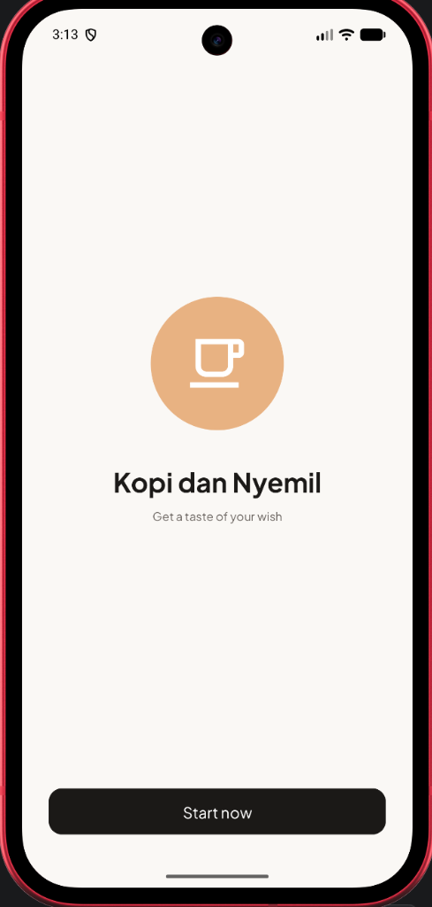
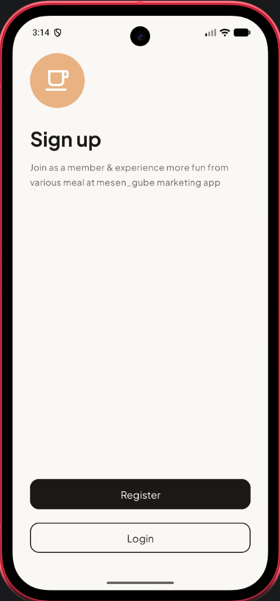
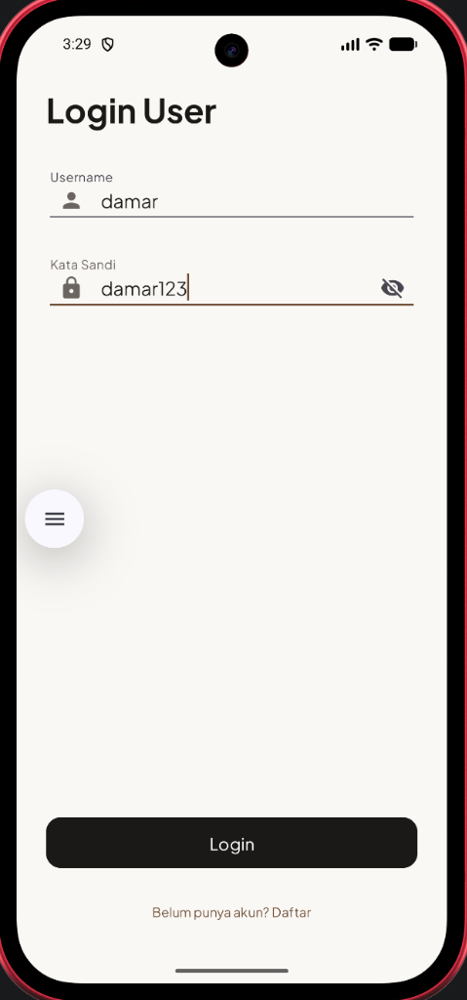
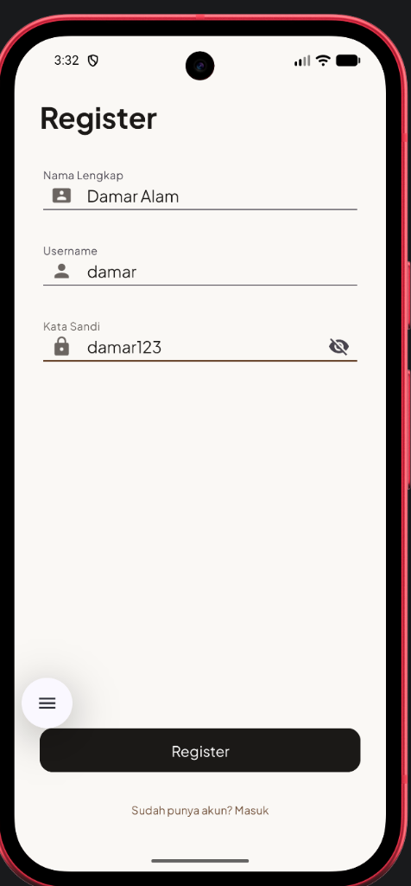
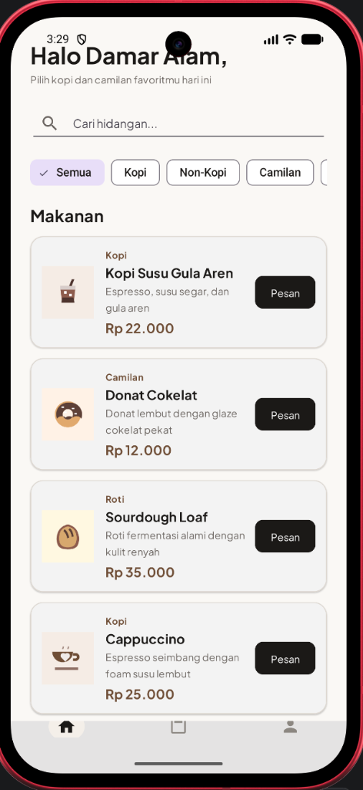
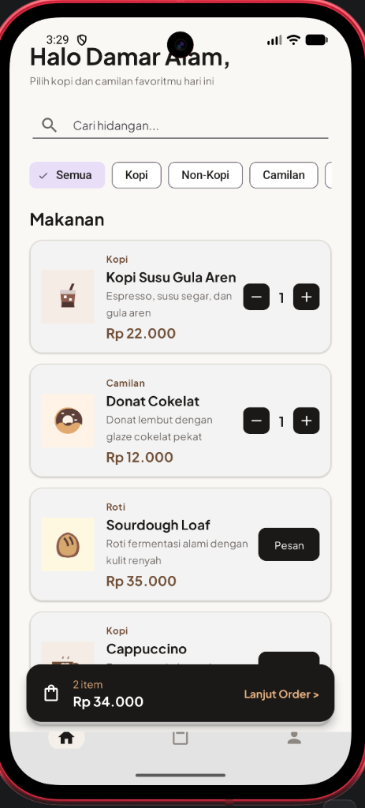
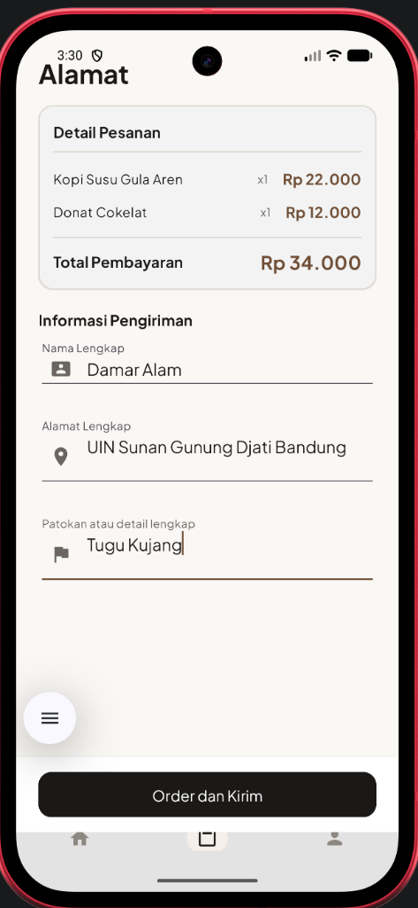
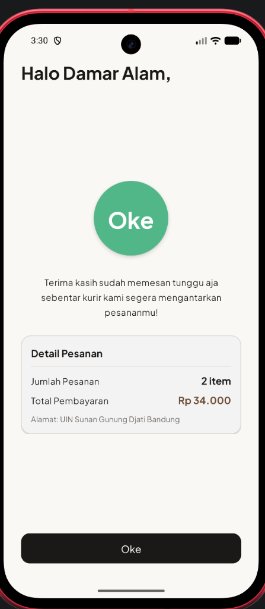
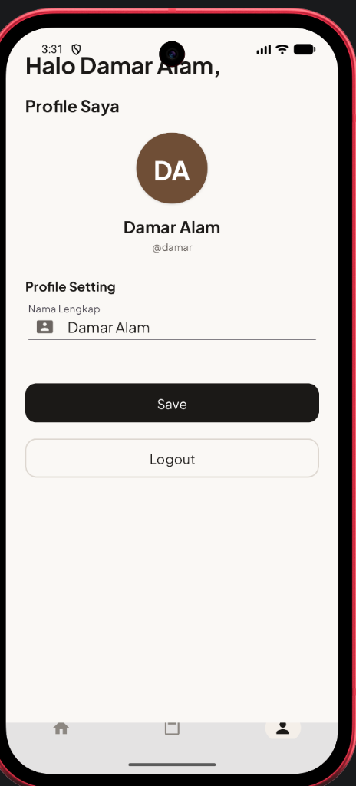

# Kopi dan Nyemil

Kopi dan Nyemil adalah aplikasi mobile pemesanan kopi dan camilan berbasis Android yang dikembangkan menggunakan bahasa pemrograman Kotlin dan Android Studio. Proyek ini dibuat untuk memenuhi tugas Ujian Akhir Semester (UAS) mata kuliah Pengembangan Aplikasi Mobile.

- Autentikasi Pengguna:
  - Splash Screen: Tampilan pembuka dengan logo aplikasi, judul, tagline, dan tombol Start now untuk memulai alur menuju halaman pilihan autentikasi.
  - Welcome / Sign Up: Halaman pilihan autentikasi untuk melanjutkan ke pendaftaran akun baru atau masuk ke akun terdaftar.
  - Register: Form pendaftaran akun baru dengan validasi nama lengkap, keunikan username, dan panjang kata sandi minimal 6 karakter.
  - Login: Form masuk dengan pencocokan username dan kata sandi terhadap akun terdaftar, dilengkapi pesan kesalahan pada field serta fitur toggle sembunyikan/tampilkan kata sandi.
  - Akun Demo: Akun bawaan yang otomatis diinisialisasi pada saat pertama kali aplikasi dibuka untuk memudahkan pengujian.
- Daftar Menu dan Pencarian:
  - Katalog Hidangan: Menampilkan 7 varian menu kopi, minuman non-kopi, camilan, dan roti lengkap dengan ilustrasi vektor khusus, nama, deskripsi, kategori, serta harga terformat Rupiah.
  - Filter Kategori: Tombol filter chip untuk menyaring menu berdasarkan kategori (Semua, Kopi, Non-Kopi, Camilan, Roti).
  - Kolom Pencarian: Input pencarian interaktif untuk menemukan menu berdasarkan nama atau deskripsi hidangan.
- Keranjang Belanja:
  - Kontrol Jumlah: Tombol tambah menu dan kontrol kuantitas (- dan +) langsung pada kartu hidangan.
  - Bar Ringkasan Mengambang: Bilah ringkasan yang muncul otomatis di atas navigasi bawah saat keranjang berisi item, menampilkan jumlah item dan total harga.
- Alamat Pengiriman:
  - Form Pemesanan: Form pengisian nama lengkap, alamat tujuan, dan patokan atau detail pengiriman tambahan.
  - Ringkasan Item: Kartu daftar hidangan yang dipesan beserta subtotal dan total biaya pembayaran.
  - Keadaan Kosong: Tampilan informatif jika tab Order diakses dalam kondisi keranjang belum terisi, disertai tombol untuk kembali melihat daftar menu.
- Konfirmasi Pesanan:
  - Status Pesanan: Tampilan konfirmasi keberhasilan pemesanan dengan lencana OK animasi, sapaan nama pengguna, pesan kurir, dan rincian ringkas pesanan.
  - Pengalihan Alur: Tombol Oke yang mengembalikan alur ke Home dengan membersihkan tumpukan aktivitas agar tidak kembali ke form pemesanan.
- Profil Pengguna:
  - Informasi Akun: Menampilkan avatar berupa inisial nama dalam lingkaran, nama lengkap, dan username.
  - Pengubahan Nama: Form edit nama lengkap dengan validasi dan konfirmasi Snackbar yang langsung memperbarui sapaan di seluruh aplikasi.
  - Logout: Tombol keluar dengan dialog konfirmasi yang membersihkan sesi pengguna dan mengembalikan ke halaman Welcome.
- Navigasi:
  - Bottom Navigation: Navigasi bawah untuk berpindah antara halaman Home, Order, dan Profile tanpa menumpuk aktivitas.

## Teknologi yang Digunakan

| Komponen | Spesifikasi / Versi |
|---|---|
| Bahasa Pemrograman | Kotlin 2.0.21 |
| Platform SDK | Android SDK (minSdk 24, compileSdk 36, targetSdk 35) |
| UI Framework | Android Material Components 3 (Material Design) |
| Layout System | ConstraintLayout, RecyclerView, CardView |
| View Binding | Android View Binding |
| Tipografi | Plus Jakarta Sans (res/font) |
| Penyimpanan Data | SharedPreferences (Sesi, Akun, Keranjang, Pengiriman) |
| Build Tool | Gradle 9.5 & Android Gradle Plugin 9.3.3 |

## Struktur Project

```
com.kopidannyemil.app/
├── SplashActivity.kt
├── WelcomeActivity.kt
├── LoginActivity.kt
├── RegisterActivity.kt
├── MainActivity.kt
├── OrderActivity.kt
├── ConfirmationActivity.kt
├── ProfileActivity.kt
├── HidanganAdapter.kt
├── PesananItemAdapter.kt
├── model/
│   ├── Akun.kt
│   ├── Hidangan.kt
│   ├── ItemMenuUi.kt
│   ├── ItemPesanan.kt
│   └── KategoriMenu.kt
├── data/
│   └── DaftarMenu.kt
├── penyimpanan/
│   ├── PenyimpananAkun.kt
│   ├── PenyimpananKeranjang.kt
│   ├── PenyimpananPengiriman.kt
│   └── PenyimpananSesi.kt
└── util/
    └── FormatRupiah.kt
```

## Cara Menjalankan Aplikasi

### Prasyarat Lingkungan
- Android Studio Ladybug / Meerkat atau versi yang lebih baru
- Java Development Kit (JDK) versi 17 atau yang kompatibel
- Android SDK Platform API 35/36

### Langkah Menjalankan di Android Studio
1. Kloning repositori ini ke komputer lokal:
   ```bash
   git clone https://github.com/amay29/Kopi-dan-Nyemil.git
   ```
2. Buka software Android Studio.
3. Pilih menu File > Open, kemudian pilih folder hasil kloning.
4. Tunggu hingga proses sinkronisasi Gradle (Gradle Sync) selesai secara otomatis.
5. Jalankan emulator (AVD) atau sambungkan perangkat fisik Android dengan USB debugging aktif.
6. Klik tombol Run (ikon segitiga hijau atau Shift + F10).

### Akun Pengujian (Demo)
Aplikasi telah menyediakan akun demo bawaan yang dapat langsung digunakan pada halaman Login:
- Username: `damar`
- Kata Sandi: `damar123`
- Nama Pengguna: `Damar Alam`

### Menjalankan Melalui Terminal (Command Line)
Untuk melakukan kompilasi file APK secara mandiri:
```bash
./gradlew assembleDebug
```
File APK hasil kompilasi tersedia pada direktori:
`app/build/outputs/apk/debug/app-debug.apk`

Untuk langsung memasang aplikasi ke perangkat yang tersambung:
```bash
./gradlew installDebug
```

## Alur Penggunaan

1. Buka aplikasi, halaman Splash menampilkan identitas aplikasi lalu pengguna menekan tombol Start now.
2. Pada halaman Sign up, pengguna dapat memilih tombol Login atau Register.
3. Jika memilih Register, isi nama lengkap, username, dan kata sandi minimal 6 karakter. Setelah berhasil, aplikasi langsung masuk ke halaman Home.
4. Jika memilih Login, masukkan username dan kata sandi yang telah terdaftar.
5. Pada halaman Home, pengguna dapat mencari menu melalui kolom pencarian atau filter kategori, lalu menekan tombol Pesan atau tombol kuantitas (+ / -) pada hidangan yang diinginkan.
6. Tekan bilah keranjang mengambang atau tab Order pada navigasi bawah untuk membuka halaman Alamat.
7. Periksa daftar menu yang dipesan, lengkapi alamat pengiriman dan patokan pengiriman, lalu tekan Order dan Kirim.
8. Halaman Konfirmasi menampilkan status pesanan berhasil. Tekan Oke untuk kembali ke halaman utama.
9. Pada tab Profile, pengguna dapat mengubah nama lengkap atau keluar dari akun melalui dialog konfirmasi logout.

## Screenshot Tampilan

Berikut merupakan referensi tangkapan layar antarmuka aplikasi:

| Layar | Tangkapan Layar |
|---|---|
| 01. Splash Screen |  |
| 02. Welcome / Sign Up |  |
| 03. Login User |  |
| 04. Register |  |
| 05. Home & Katalog Menu |  |
| 06. Keranjang Belanja |  |
| 07. Form Alamat Pengiriman |  |
| 08. Konfirmasi Pesanan |  |
| 09. Profile Pengguna |  |

## Identitas Pembuat

- Nama Mahasiswa: Damar Alam
- NIM: 1247050073
- Mata Kuliah: Pengembangan Aplikasi Mobile
- Program Studi: Teknik Informatika
