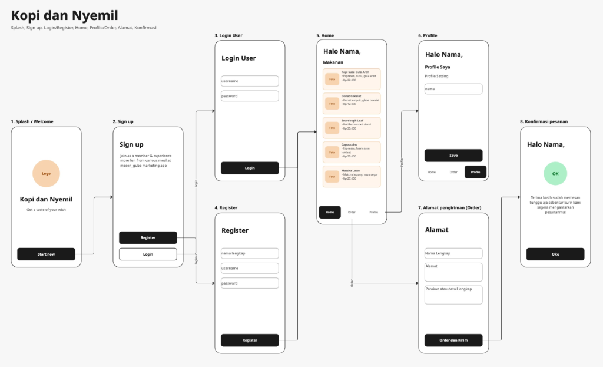

# Kopi dan Nyemil

Aplikasi mobile pemesanan kopi dan camilan berbasis Android yang dibuat berdasarkan wireframe tugas UAS Pemrograman Aplikasi Mobile (PAM).

## Deskripsi Aplikasi
Kopi dan Nyemil adalah aplikasi pemesanan makanan dan minuman sederhana. Aplikasi ini memungkinkan pengguna untuk melihat daftar menu kopi dan camilan, mengubah profil nama pengguna, mengisi alamat pengiriman, serta menerima konfirmasi pesanan. Aplikasi menggunakan data statis (dummy data) dan SharedPreferences untuk menyimpan data pengguna tanpa memerlukan database eksternal.

## Fitur
- **Splash / Welcome Screen**: Halaman awal dengan logo dan tombol untuk memulai.
- **Sign Up**: Halaman pilihan untuk menuju form Login atau Register.
- **Login User**: Form masuk dengan input username dan password.
- **Register**: Form pendaftaran akun baru dengan input nama lengkap, username, dan password.
- **Home**: Menampilkan sapaan dinamis sesuai nama pengguna ("Halo [Nama],") dan daftar menu kopi & camilan (7 item) lengkap dengan foto/ikon, nama, deskripsi, harga, dan tombol pesan.
- **Profile**: Menampilkan info profil pengguna dengan fitur edit nama yang otomatis memperbarui nama pada sapaan aplikasi, serta tombol logout.
- **Alamat Pengiriman (Order)**: Form pengisian nama lengkap, alamat pengiriman, dan patokan pengiriman disertai ringkasan menu yang dipesan.
- **Konfirmasi Pesanan**: Halaman status pemesanan berhasil dengan lencana OK dan pesan konfirmasi pengantaran kurir.
- **Bottom Navigation**: Navigasi bawah untuk berpindah antar halaman Home, Order, dan Profile.

## Teknologi yang Digunakan
- **Bahasa Pemrograman**: Kotlin
- **IDE**: Android Studio
- **Platform**: Android SDK (minSdk: 24, compileSdk: 36, targetSdk: 35)
- **UI / Layout**: XML Layout, View Binding, Material Components 3, RecyclerView, ConstraintLayout
- **Penyimpanan Lokal**: SharedPreferences
- **Build Tool**: Gradle

## Cara Menjalankan Aplikasi

### Menggunakan Android Studio
1. Buka Android Studio.
2. Pilih **File > Open**, lalu arahkan ke folder proyek ini.
3. Tunggu proses Gradle Sync selesai.
4. Pilih emulator (AVD) atau perangkat fisik Android yang terhubung.
5. Klik tombol **Run** (Shift + F10).

### Menggunakan Terminal
Jalankan perintah berikut untuk meng-compile file APK debug:
```bash
./gradlew assembleDebug
```
File APK akan tersimpan di:
`app/build/outputs/apk/debug/app-debug.apk`

## Screenshot Tampilan

Berikut adalah tampilan antarmuka aplikasi berdasarkan alur wireframe:


